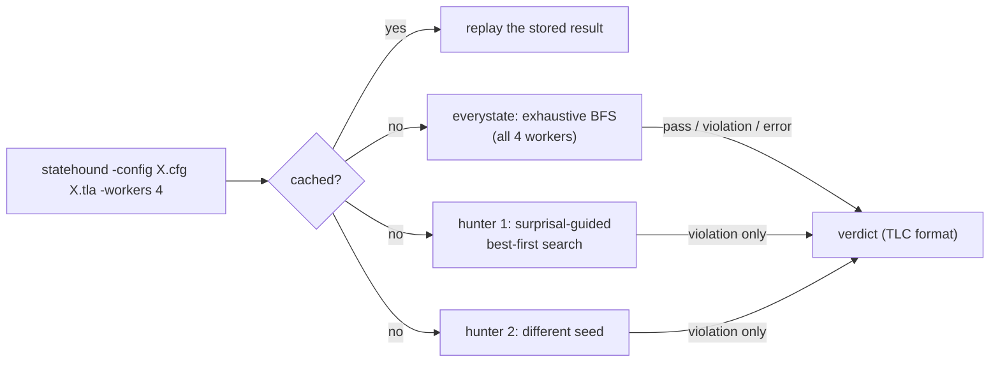

# Statehound

**A pure-Rust, drop-in replacement for the Java TLA+ model checker (TLC), built to make agent-driven
TLA+ bug hunting fast.** No JVM.

Statehound runs every check on [everystate](https://github.com/mattzcarey/everystate), a native TLA+
model checker, and races the exhaustive search against **guided hunters** that steer through the state
space towards states nobody has seen yet. A violation from either side ends the run; a pass only ever
comes from the exhaustive search. Identical checks are answered from a content-addressed cache. The
command line, the output and the exit codes are TLC's, so tools that drive or parse TLC keep working.

| On 99 real model-checking jobs from an agent-driven bug-finding pipeline | TLC (4 workers) | Statehound (4 workers) |
|---|---:|---:|
| All jobs | 780 s | 334 s (**2.3x**) |
| Jobs with a bug | 128 s | 13 s (**9.8x**) |
| Jobs that pass | 570 s | 315 s (1.8x) |
| Liveness jobs | 81 s | 4 s (22x) |
| Same verdict as TLC | | 99 / 99 |

The guided hunter alone found the violation in 207 of 210 runs (70 buggy specs x 3 seeds), with a median
of 0.02 s on one thread; every reported trace passed a replay check. Details and caveats:
[docs/results.md](docs/results.md).

## How it works, in one picture



- [How model checking works](docs/how-model-checking-works.md): states, interleavings, breadth-first
  search, invariants and counterexamples, on a small runnable example.
- [Proofs and model checking](docs/proofs.md): what a pass means, inductive invariants, and how a model
  checker finds a counterexample to induction.
- [Guided hunting](docs/guided-hunting.md): the search strategies (surprisal, MCTS, Thompson sampling,
  Boltzmann annealing, Good–Turing stopping) and why the hunters can never make a verdict wrong.
- [Pipeline integration](docs/pipeline-integration.md): using Statehound inside a TLA+ bug-finding
  pipeline instead of Java.
- [Results](docs/results.md): every number, how it was measured.

## Install

Requirements: Rust (via [rustup](https://rustup.rs)) and git. No Java.

```sh
git clone https://github.com/allthingssecurity/statehound
cd statehound
scripts/install.sh                 # builds everystate (pinned + patch) and statehound into ~/.local/bin
scripts/install.sh --claude        # also install the skill for Claude Code
scripts/install.sh --codex         # also install the skill for Codex
```

Check it:

```sh
cd examples/lost-update
statehound -config LostUpdate.cfg LostUpdate.tla       # finds the lost update, exit status 12
statehound -config LockedUpdate.cfg LockedUpdate.tla   # the fixed version passes, exit status 0
```

## Use it

```sh
statehound -config Spec.cfg Spec.tla -workers 4             # exhaustive check + 2 hunters
statehound -config Spec.cfg Spec.tla -workers 4 -deadlock   # don't check deadlock (TLC's meaning)
everystate -config Spec.cfg Spec.tla -hunt budget=120       # hunt only, for state spaces too big to finish
```

| Variable | Default | Meaning |
|---|---|---|
| `STATEHOUND_EVERYSTATE` | `everystate` on PATH | the engine binary |
| `STATEHOUND_HUNTERS` | 2 | hunters next to the exhaustive search (0 = exhaustive only) |
| `STATEHOUND_HUNT_OPTS` | `budget=60,max=5000000` | options for each hunter (`everystate -hunt ...`) |
| `STATEHOUND_CACHE` | `~/.cache/statehound` | result cache directory (`off` disables) |
| `STATEHOUND_LOG` | unset | append one JSON line per run (decisions, timings) |

Exit status: 0 no error, 10 assumption failed, 11 deadlock, 12 safety violation, 13 liveness violation,
150 parse error, 151 config error, 255 other error.

## Formal verification of a whole repository

With the skill installed (`scripts/install.sh --claude` or `--codex`), open Claude Code or Codex in a
repository and say:

> *Do formal verification of this repo.*

The skill takes it from there:

1. It asks which installation to use when you have several (for example `claude default`,
   `claude account2`, `claude sap`; `statehound audit --list-profiles` shows them), and how deep to go,
   quoting a time and cost estimate for each depth:

   | Depth | Hunt areas | Scope ladder | Reproduced against the code | Per area |
   |---|---|---|---|---|
   | `short` | up to 4 | smallest scope only | the top finding of each area | 15–35 min |
   | `medium` | up to 8 | two steps up | high and critical findings | 35–75 min |
   | `full` | up to 20 | until checks exceed the budget | every finding | 1–3 h |

2. `statehound audit` **scans** every source file (Java, Go, Rust, Python, C/C++, C#, JS/TS, Kotlin,
   Scala, Erlang/Elixir, Ruby) and scores each directory on concurrency and distributed-systems signals.
3. One agent **surveys** the top candidates and writes the queue of hunt areas: the mechanism, its files,
   the actors, the shared state, the failures to model, and the properties that must hold.
4. One agent per area **hunts**, several in parallel, each in its own git worktree (your checkout is never
   touched): it models the mechanism, writes the TLA+ spec, checks it with `statehound` on a growing
   scope ladder (2 actors, then 3, more failures, ...), triages every counterexample, and reproduces
   candidate bugs against the real code with a test.
5. **`AUDIT.md`** lists confirmed bugs first (with trace, code locations and the reproduction), then
   model-only leads, then the properties verified clean and the scope each was verified to.

The time estimate is recomputed after every finished area from the measured durations of the run.
Re-running the same command resumes. You can also run it directly:

```sh
statehound audit /path/to/repo --depth medium --agent claude --profile default --parallel 3
statehound audit /path/to/repo --depth short --dry-run     # scan + estimate, no agent started
statehound scan /path/to/repo                             # just the ranked list of candidate areas
```

Output goes to `~/.statehound/audits/<repo>/` (`--out` to change it).

## With Claude Code or Codex, one spec at a time

You can also ask for single tasks in plain words:

- *"Model check `specs/Raft.tla` with statehound and explain the counterexample step by step."*
- *"Is `Inv` in `Lock.tla` inductive? Use statehound to find a counterexample to induction."*

The skill is in [`skills/statehound/SKILL.md`](skills/statehound/SKILL.md) and works the same way for
both agents (Claude Code reads `~/.claude/skills/`, Codex reads `~/.codex/skills/`).

To run the full TLA+ bug-finding pipeline ([github.com/specular-org/Specular](https://github.com/specular-org/Specular))
without Java, see [docs/pipeline-integration.md](docs/pipeline-integration.md).

## Status

Done and measured: the `statehound` portfolio, `everystate -hunt`, `statehound scan` / `audit`, the
skill, the pipeline integration for model checking, `-dumpTrace json|tla` / `-loadTrace json` (with the
pipeline's trace replay), `-debugger` (TLC's DAP debugger, with the pipeline's trace debugger tool). In
progress, landing as separate commits as each is verified against Java TLC: `-continue`, `-coverage`, a
SANY-equivalent parse check, and the Rust port of the CFA `vav` tool. Until an option lands, `statehound` refuses it with a clear message.

Measured and not adopted: diagram-equivalence (partial-order) pruning in the hunters. Over 840 runs it found
nothing extra and was about 7% slower; see [docs/guided-hunting.md](docs/guided-hunting.md).

## Repository layout

| Path | What |
|---|---|
| `crates/statehound/` | the `statehound` binary (portfolio, cache, process supervision) |
| `patches/everystate/` | the everystate patch series: `0001` `-hunt` (guided hunting) and supervision support, `0002` `-dumpTrace` / `-loadTrace`, `0003` `-debugger` (DAP) |
| `patches/pipeline/` | patches that make the bug-finding pipeline use Statehound instead of Java |
| `skills/statehound/` | the agent skill |
| `examples/lost-update/` | the runnable example used throughout the docs |
| `docs/` | explainers and results |
| `bench/` | benchmark scripts and raw results |
| `scripts/install.sh` | build and install |

## License and credits

Statehound is Apache-2.0. It builds on [everystate](https://github.com/mattzcarey/everystate) (MIT,
Matt Carey); the patch in `patches/everystate/` is distributed under everystate's MIT license. The
pipeline patches apply to the Apache-2.0 TLA+ bug-finding pipeline at
[github.com/specular-org/Specular](https://github.com/specular-org/Specular). Java TLC
(github.com/tlaplus/tlaplus) was used only as a test oracle, never at run time.
