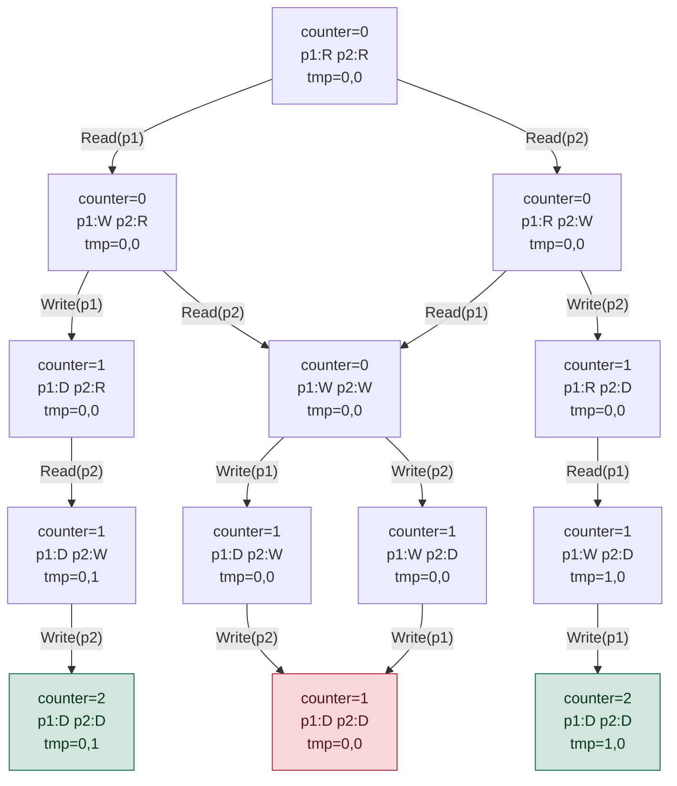

# How model checking works

This page explains what a TLA+ model checker does, using one small spec that ships with this repo:
[`examples/lost-update/LostUpdate.tla`](../examples/lost-update/LostUpdate.tla). Every output on this page
was produced by running that spec; run the commands yourself to see the same results.

## 1. A spec is a state machine

A TLA+ spec describes a system as a set of **variables**, an **initial condition** and a **next-state
relation**:

- A **state** is one value for every variable.
- `Init` says which states the system can start in.
- `Next` says which steps are possible from any state. It is usually a disjunction of **actions**, one per
  kind of step.

`LostUpdate` models two processes, `p1` and `p2`, each adding 1 to a shared `counter`. Adding is done in
two separate steps, the way a program does `tmp = counter; counter = tmp + 1`:

```tla
Read(p)  == /\ pc[p] = "read"
            /\ tmp' = [tmp EXCEPT ![p] = counter]   \* remember the counter
            /\ pc'  = [pc  EXCEPT ![p] = "write"]
            /\ UNCHANGED counter

Write(p) == /\ pc[p] = "write"
            /\ counter' = tmp[p] + 1                \* write back what was read, plus 1
            /\ pc' = [pc EXCEPT ![p] = "done"]
            /\ UNCHANGED tmp

Next == \E p \in Procs : Read(p) \/ Write(p)
```

A primed variable (`counter'`) is the variable's value in the next state. An action is a condition on a
pair of states: `Write(p)` is possible only when `pc[p] = "write"` (its **guard**), and it determines
the new values.

## 2. Concurrency is interleaving

`Next` says "some process takes its next step". It does not say which one, so from a state where both
processes can move, there are two successors. Following every choice from the initial state gives the
**state graph**: every reachable state, and every step between them. For `LostUpdate` with two processes
it has 13 states:



(R = about to read, W = about to write, D = done. Generated from the checker's own state-graph dump with
`-dump dot,actionlabels`; see `examples/lost-update/state-graph.mmd`.)

Each path from the top to the bottom is one **interleaving**, one possible order in which the two
programs' steps happen. Three end states exist. In S10 and S12 the counter is 2, as intended. In **S11**
it is 1: both processes read 0 before either wrote, so one increment was lost. Notice that S11 is reached
by two different orders (`…Write(p1), Write(p2)` and `…Write(p2), Write(p1)`): states, not paths, are
what the checker stores, which is why the graph has 13 states although there are 6 interleavings.

## 3. Invariants

An **invariant** is a condition that must hold in every reachable state. The spec states two:

```tla
TypeOK       == /\ counter \in 0..Cardinality(Procs)
                /\ pc \in [Procs -> {"read", "write", "done"}]

AllDone      == \A p \in Procs : pc[p] = "done"
NoLostUpdate == AllDone => counter = Cardinality(Procs)
```

The configuration file names the constants and the invariants to check:

```
SPECIFICATION Spec
CONSTANT Procs = {p1, p2}
INVARIANT TypeOK
INVARIANT NoLostUpdate
CHECK_DEADLOCK FALSE
```

## 4. Breadth-first exhaustive search

TLC, everystate and Statehound's exhaustive mode all run the same algorithm:

```text
queue  := all states satisfying Init        (each checked against the invariants)
seen   := fingerprints of those states       (a fingerprint is a 64-bit hash of a state)
parent := {}                                 (how each state was first reached)

while queue is not empty:
    s := pop the front of queue
    for each action A, for each successor t of s by A:
        if fingerprint(t) is in seen: continue          -- already explored
        add fingerprint(t) to seen; parent[t] := (s, A)
        for each invariant I:
            if I is false in t:
                report a counterexample: follow parent[] from t back to an initial state
                stop
        append t to queue
report "No error has been found", with the numbers of states generated and distinct states
```

Three properties of this loop matter in practice:

- **Every reachable state is checked**, within the bounds the constants set (here: two processes). That
  is what makes "No error has been found" meaningful, and also why it only covers those bounds.
- **The counterexample is a shortest one.** Breadth-first search visits states in order of distance from
  the start, so the first violating state found is at minimal depth, and following `parent` gives a
  shortest path to it. With several worker threads TLC relaxes the strict level order: on the benchmark
  corpus, 4-worker TLC returned traces 1 to 2 steps longer than the shortest on 7 specs, while
  single-worker TLC and everystate returned the shortest.
- **States are stored once.** Different interleavings that reach the same state (S4, S11 above) are
  explored once. This is what keeps exhaustive search feasible at all.

## 5. The counterexample

Run it:

```sh
everystate -config LostUpdate.cfg LostUpdate.tla
```

```text
Error: Invariant NoLostUpdate is violated.
Error: The behavior up to this point is:
State 1: <Initial predicate>
/\ counter = 0
/\ pc = (p1 :> "read" @@ p2 :> "read")
/\ tmp = (p1 :> 0 @@ p2 :> 0)

State 2: <Read(p1) line 19, col 13 to line 22, col 32 of module LostUpdate>
/\ counter = 0
/\ pc = (p1 :> "write" @@ p2 :> "read")
/\ tmp = (p1 :> 0 @@ p2 :> 0)

State 3: <Read(p2) line 19, col 13 to line 22, col 32 of module LostUpdate>
/\ counter = 0
/\ pc = (p1 :> "write" @@ p2 :> "write")
/\ tmp = (p1 :> 0 @@ p2 :> 0)

State 4: <Write(p1) line 24, col 13 to line 27, col 28 of module LostUpdate>
/\ counter = 1
/\ pc = (p1 :> "done" @@ p2 :> "write")
/\ tmp = (p1 :> 0 @@ p2 :> 0)

State 5: <Write(p2) line 24, col 13 to line 27, col 28 of module LostUpdate>
/\ counter = 1
/\ pc = (p1 :> "done" @@ p2 :> "done")
/\ tmp = (p1 :> 0 @@ p2 :> 0)

13 states generated, 12 distinct states found, 3 states left on queue.
The depth of the complete state graph search is 5.
```

Read it as a story: both processes read 0 (states 2 and 3), `p1` writes 1, `p2` writes 1, and the
invariant fails. It is a **counterexample**: a concrete execution showing that the property does not
hold. It is also exactly the path S0 → S1 → S4 → S7 → S11 in the graph above. The search stopped as soon
as it reached S11, with 3 states still queued.

In a bug-finding pipeline this trace is what an agent turns into a test against the real code: two
threads, read-read-write-write, assert the counter is 2.

## 6. The fix, checked

[`LockedUpdate.tla`](../examples/lost-update/LockedUpdate.tla) adds a lock: `Read(p)` requires
`lock = Free` and takes the lock, `Write(p)` gives it back. Checking it:

```text
Model checking completed. No error has been found.
9 states generated, 9 distinct states found, 0 states left on queue.
The depth of the complete state graph search is 5.
```

The lock removes the interleavings in which both processes are between read and write, and every
remaining state satisfies `NoLostUpdate`. See [proofs.md](proofs.md) for how to show this holds for
every number of processes, not only two.

## 7. State explosion

The state graph grows exponentially with the number of processes. Measured for `LostUpdate` (without
the lock, all states, exhaustive):

| Processes | Distinct states |
|---:|---:|
| 2 | 13 |
| 3 | 84 |
| 4 | 755 |
| 5 | 8,638 |
| 6 | 118,509 |

Real specs written for distributed systems reach tens of millions of states within minutes, and many
never finish. Ways to cope, all supported by the engines here:

- **Small constants.** Most concurrency bugs show up with 2 or 3 processes (the "small scope hypothesis").
- **`CONSTRAINT`**: a state predicate that cuts the search off at states outside it (for example a bound
  on message counts).
- **`SYMMETRY`**: when processes are interchangeable, states that differ only by a permutation of process
  names are explored once.
- **`VIEW`**: states are compared on an expression of the variables (for example ignoring a history
  variable).
- **Guided hunting**, when the goal is to find a bug fast rather than to prove there is none: see
  [guided-hunting.md](guided-hunting.md).

## 8. Other kinds of property

- **Deadlock**: a state with no successor at all. With `CHECK_DEADLOCK TRUE` (TLC's default), reaching
  one is an error and is reported with a trace. `LostUpdate` turns it off because "all done" is a
  legitimate end state.
- **Action properties** (`[][A]_v` under `PROPERTY`): conditions on each *step*, checked on every pair of
  a state and its successor.
- **Liveness** ("eventually", "infinitely often", under fairness assumptions): checked on the state graph
  after the search. A counterexample is a **lasso**, a path that ends in a cycle along which the property
  never becomes true.

## Glossary

| Term | Meaning |
|---|---|
| state | a value for every variable |
| action | a kind of step, a condition on a state and its successor |
| interleaving | one order in which the steps of concurrent processes happen |
| state graph | all reachable states and the steps between them |
| fingerprint | a 64-bit hash identifying a state in the `seen` set |
| invariant | a state condition that must hold in every reachable state |
| counterexample | a path from an initial state to a state (or cycle) that breaks a property |
| distinct states | how many different states were reached |
| states generated | how many successors were computed, duplicates included |
